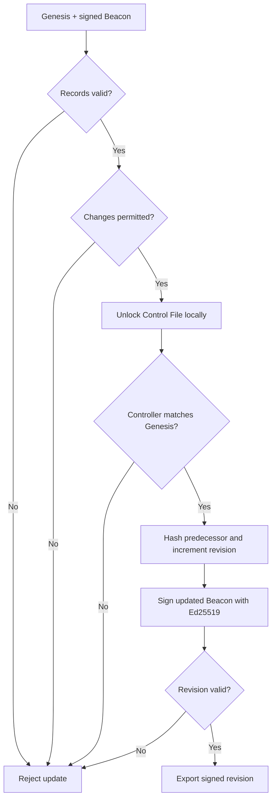
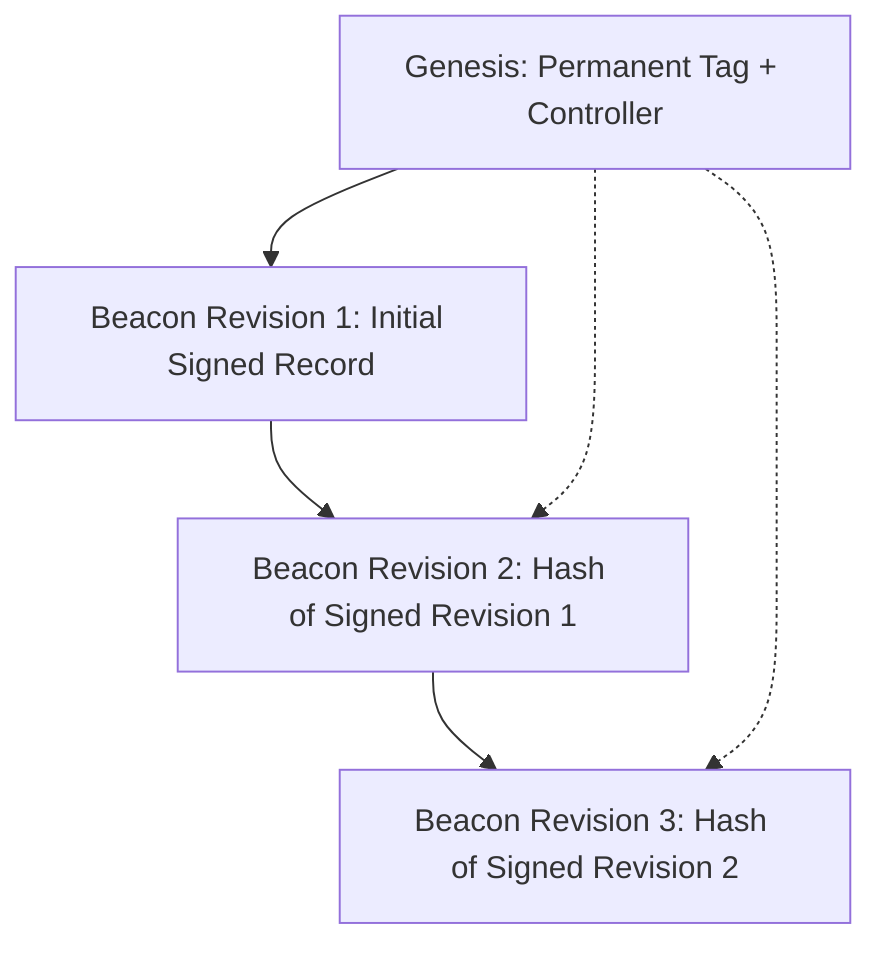
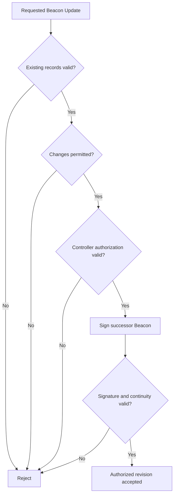

# Authorized Beacon Updates and Controller Continuity

**Project:** Machine Open Tag & Beacon (MOTB-8)
**Version:** Core v0.1 architecture, Beacon schema v1.1
**Status:** Implemented and tested in Node.js and browser environments

## 1. Architectural Principle

**An immutable identity does not mean immutable information.**

MOTB-8 separates a permanent machine identity from its mutable, signed
machine-presence information.

The permanent MOTB-8 Tag identifies a machine presence. Its Genesis Record
binds that Tag to the initial controller public key.

The Beacon describes the machine presence and may evolve through authorized,
cryptographically signed revisions.

The permanent Tag does not change when the Beacon changes.

## 2. Permanent and Mutable Components

| Component | Behavior |
|---|---|
| MOTB-8 Tag | Permanent identity; unchanged across revisions |
| Genesis Record | Original signed controller binding; unchanged |
| Controller public key | Preserved across v0.1 Beacon revisions |
| Encrypted Control File | Operator-held credential used for authorization |
| Beacon | Mutable signed public machine-presence record |
| Revision number | Increases by exactly one |
| Previous Beacon hash | Links each revision to its predecessor |
| Original createdAt | Preserved |
| updatedAt | Advances with each revision |

Controller rotation and recovery are outside the current v0.1 update model.

## 3. Authorized Update Workflow

The operator supplies the signed public records, encrypted Control File, and passphrase.
All private-key operations occur locally.

## 4. The Authorization Gate

Possession of a public MOTB-8 Tag does not grant control over its Beacon.

An authorized browser update requires:

1. Verification of the Genesis Record and existing signed Beacon.
2. Validation of changes against permitted mutable fields.
3. Decryption of the operator-held Control File using its passphrase.
4. Proof that the recovered controller private key matches Genesis.
5. Ed25519 signing of the updated Beacon.
6. Verification of the new signature and revision continuity.

### Controller Authorization

The recovered private key signs a random challenge.
The challenge signature is verified against the controller public key in Genesis.

The recovered browser private key is non-extractable.
The encrypted Control File uses scrypt and AES-256-GCM.

Successful authorization establishes possession of the controller credential
associated with the supplied Genesis binding.

It does not independently establish original ownership of a publicly copyable Tag.

## 5. Beacon Revision Chain

Each Beacon v1.1 revision after revision 1 references its immediate predecessor.
The permanent Tag, Genesis binding, and controller remain unchanged.

Each new revision contains:

- A revision number incremented by exactly one.
- The SHA-256 hash of the complete signed predecessor Beacon.
- The original creation timestamp.
- A strictly advancing update timestamp.
- A new Ed25519 signature from the authorized controller.

### Canonical Predecessor Hash

1. Validate the complete signed predecessor Beacon.
2. Canonicalize the entire record using RFC 8785 JCS.
3. Encode the canonical representation as UTF-8.
4. Calculate SHA-256, including the signature proof.
5. Represent the digest as 64 lowercase hexadecimal characters.

Browser hashing uses Web Crypto SHA-256.
Node.js hashing uses Node's cryptographic implementation.
Both implementations produce identical hashes for the same signed Beacon.

## 6. Mutable and Protected Beacon Fields

Authorized updates may change supported machine-presence information.

### Permitted Mutable Fields

- Machine name and description.
- Presence type and scope, including conditional fields.
- Taxonomy and capabilities.
- Public profiles and contacts.
- Reachability and protocols.
- Native and external catalogs.
- Relationships and attachments.

### Protected Identity and Revision Fields

The following fields cannot be supplied as ordinary Beacon changes:

- `motb8Tag`
- `controller`
- `createdAt`
- `goodFaith`
- `revision`
- `previousBeaconHash`
- `proof`

The update implementation calculates revision metadata internally.
It signs the resulting Beacon using the authorized controller.

Controller rotation is not part of the current v0.1 update operation.

## 7. Unauthorized Modification Versus Authorized Revision

MOTB-8 rejects unauthorized changes to signed Beacon records.
Authorized revisions do not weaken that protection.

| Attempt | Expected Result |
|---|---|
| Modify signed Beacon JSON without signing | Reject |
| Incorrect Control File passphrase | Reject |
| Substitute another controller | Reject |
| Change protected identity fields | Reject |
| Submit tampered predecessor | Reject |
| Authorized controller signs permitted changes | Accept after verification |

## 8. Local Files and Independent Operation

MOTB-8 does not require conventional accounts, a central registry,
server-side private-key custody, or mandatory blockchain anchoring.

The operator supplies the Genesis Record, existing signed Beacon,
encrypted Control File, and passphrase to the local implementation.

Cryptographic relationships between these records establish whether
the supplied controller credential can authorize a new revision.

Filenames and storage locations do not confer authority.
Generating a signed revision does not automatically publish it.

## 9. Verification Limitations

### Controller Continuity

A valid signed revision demonstrates continuity with the controller
identified by the supplied Genesis Record.

### Original Ownership

VALID_UNANCHORED confirms a valid self-signed Genesis binding.
It does not independently establish original ownership of the Tag.

### Latest Published Revision

A valid revision pair does not prove that the supplied Beacon is
the latest published revision or that no conflicting successor exists.
Complete revision-history verification is a separate operation.

### Publication

A valid updated Beacon is not automatically published.
Operators must distribute or publish updated public records separately.

### Credential Custody

Loss of the encrypted Control File or its usable passphrase may
prevent future authorized updates under the current v0.1 model.
Operators are responsible for secure credential backups.

## 10. Core API References

### Browser APIs

- `computeBrowserBeaconHash()`
- `verifyBrowserBeaconRevision()`
- `updateBrowserPresenceBeacon()`
- `unlockBrowserControlFile()`
- `verifyBrowserGenesisRecord()`
- `verifyBrowserBeacon()`

### Node.js APIs

- `computeBeaconHash()`
- `verifyBeaconRevision()`
- `updatePresenceBeacon()`
- `unlockControlFile()`

## 11. Verification Evidence

Phase 23A.6 browser integration passed:

- 5 browser/Node hashing parity tests.
- 9 browser/Node revision verification parity tests.
- 7 authorized browser update tests.
- 319 tests in the complete MOTB-8 core regression suite.

The tests cover incorrect passphrases, substituted controllers,
protected-field changes, tampered predecessors, and independent
Node verification of browser-generated signed revisions.

## 12. Architectural Conclusion

The MOTB-8 Tag is permanent.
The Genesis Record binds the Tag to its initial controller.
The Beacon evolves through authorized, cryptographically linked revisions.

**Identity persistence and information mutability are complementary
properties of MOTB-8, not contradictory ones.**
